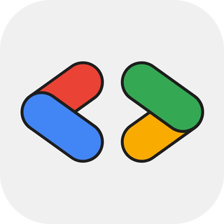
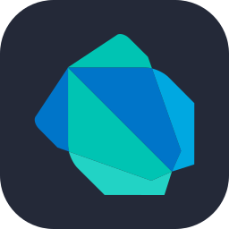
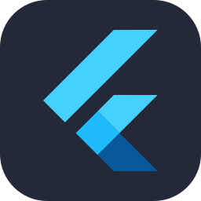
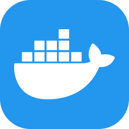
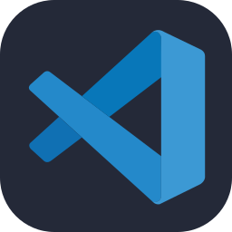
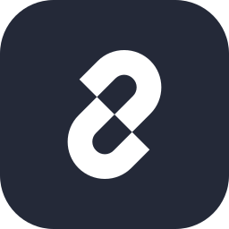
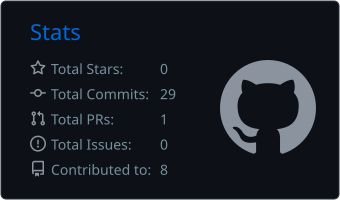
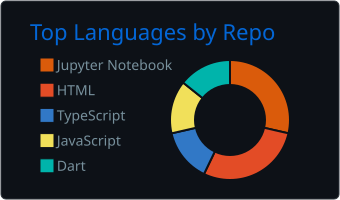

  

  

  <a href="https://ahmed-portfolio-orcin-chi.vercel.app"><b>Portfolio</b></a>
  &nbsp;&nbsp;·&nbsp;&nbsp;
  <a href="https://www.linkedin.com/in/ahmed-srour-335844405/"><b>LinkedIn</b></a>
  &nbsp;&nbsp;·&nbsp;&nbsp;
  <a href="mailto:ahmadsrour537@gmail.com"><b>Email</b></a>

## About me

I'm Ahmed, a final-year Smart Systems and Computer Engineering student at Al-Aqsa University in Gaza, Palestine. Most of what I build is mobile. I work with Flutter and Dart, and I care about how an app is put together underneath as much as how it looks on screen.

Alongside mobile, I'm drawn to artificial intelligence and data science. I've worked through machine learning projects in Python, and AI-assisted tools are part of how I plan, write, and review code.

I learn fastest by building things people can use, so my projects tend to start from a real need: a clinic that needs one shared appointment schedule, a course that needs a working app, a dataset that has to be cleaned before anyone can model it. I'm also part of the developer community on campus, as a member of the GDG technical team.

## Community

<table>
  <tr>
    <td align="center">
      
    </td>
    <td>
      <b>Google Developer Groups on Campus – Al-Aqsa University</b> 
      Technical Team Member  
        
      A student developer community at Al-Aqsa University. I'm part of its technical team.
    </td>
  </tr>
</table>

## Technical skills

**Programming languages**

  
  
  
   
  Dart · Python · Java

**Mobile development**

  
   
  Flutter

**Tools and technologies**

  
  
  
  
  
  
  
   
  Git · GitHub · SQLite · Docker · Linux · Android Studio · VS Code

**AI and development**

  
  
   
  LangChain · Claude · AI-assisted development tools

## Featured projects

<table>
  <tr>
    <td>
      <b>Patient Appointment System</b>  
      A clinic appointment platform: a Flutter client for desktop and mobile, backed by an ASP.NET Core API and PostgreSQL. Role-based access, real-time updates between devices, PDF and Excel reports, and Arabic and English localization.  
      <code>Flutter</code> <code>Riverpod</code> <code>ASP.NET Core</code> <code>PostgreSQL</code> <code>SignalR</code>  
      Private repository
    </td>
  </tr>
  <tr>
    <td>
      <b><a href="https://github.com/eng-Ahmed2004/student-management-app">Student Management App</a></b>  
      A Flutter app for managing student records, built for a Mobile Application Development course. Full CRUD on a local SQLite database, search, a persistent login session, and a dark mode setting.  
      <code>Flutter</code> <code>Dart</code> <code>SQLite</code> <code>SharedPreferences</code>  
      <a href="https://github.com/eng-Ahmed2004/student-management-app">Repository</a>
    </td>
  </tr>
  <tr>
    <td>
      <b><a href="https://github.com/eng-Ahmed2004/customer-personality-analysis">Customer Personality Analysis</a></b>  
      A machine learning notebook on a marketing dataset of 2,240 customers: regression on spending, classification of campaign response, and customer segmentation with K-Means and PCA.  
      <code>Python</code> <code>scikit-learn</code> <code>pandas</code> <code>Seaborn</code>  
      <a href="https://github.com/eng-Ahmed2004/customer-personality-analysis">Repository</a>
    </td>
  </tr>
  <tr>
    <td>
      <b><a href="https://github.com/eng-Ahmed2004/house-prices-preprocessing">House Prices Preprocessing</a></b>  
      A data preparation pipeline for the Kaggle House Prices dataset: cleaning, outlier removal, exploratory analysis, feature engineering, and encoding into model-ready tables.  
      <code>Python</code> <code>pandas</code> <code>NumPy</code> <code>Matplotlib</code>  
      <a href="https://github.com/eng-Ahmed2004/house-prices-preprocessing">Repository</a>
    </td>
  </tr>
  <tr>
    <td>
      <b><a href="https://github.com/eng-Ahmed2004/ahmed-portfolio">Personal Portfolio</a></b>  
      My portfolio site, in English and Arabic with dark and light themes. Content lives in data files, separate from the components that render it.  
      <code>Next.js</code> <code>TypeScript</code> <code>Tailwind CSS</code> <code>Framer Motion</code>  
      <a href="https://github.com/eng-Ahmed2004/ahmed-portfolio">Repository</a> · <a href="https://ahmed-portfolio-orcin-chi.vercel.app">Live site</a>
    </td>
  </tr>
  <tr>
    <td>
      <b><a href="https://github.com/eng-Ahmed2004/phone-compare-pro">Phone Compare Pro</a></b>  
      A responsive phone comparison site with filtering, sorting, side-by-side comparison, saved favourites, and dark mode, written without frameworks.  
      <code>HTML</code> <code>CSS</code> <code>JavaScript</code>  
      <a href="https://github.com/eng-Ahmed2004/phone-compare-pro">Repository</a> · <a href="https://eng-ahmed2004.github.io/phone-compare-pro/">Live demo</a>
    </td>
  </tr>
</table>

## GitHub activity

  
  

  

  <picture>
    <source media="(prefers-color-scheme: dark)" srcset="https://raw.githubusercontent.com/eng-Ahmed2004/eng-Ahmed2004/output/snake-dark.svg">
    <source media="(prefers-color-scheme: light)" srcset="https://raw.githubusercontent.com/eng-Ahmed2004/eng-Ahmed2004/output/snake.svg">
    
  </picture>

## Contact

  
  &nbsp;&nbsp;
  
  &nbsp;&nbsp;
  
  &nbsp;&nbsp;
  
  &nbsp;&nbsp;
  

  Open to collaboration on Flutter and mobile projects. The fastest way to reach me is email or LinkedIn.

